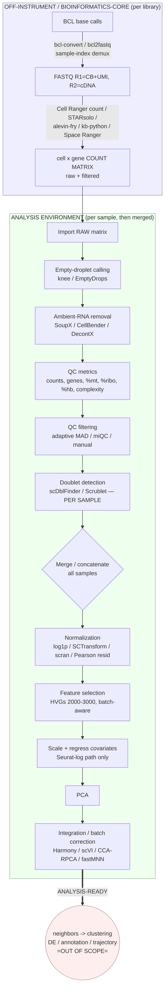

# 04 — Pipeline Steps: RAW DATA → ANALYSIS-READY

> **What this doc is.** The step-by-step *story* of everything people DO to turn
> raw single-cell / single-nucleus / spatial sequencing output into an
> **analysis-ready** object. For each step: the **WHAT**, the **WHY**, the
> **inputs/outputs**, the **decision points/tradeoffs**, how the two ecosystems
> (**Scanpy/Python** vs **Seurat + Bioconductor/R**) differ, and how the
> modalities (**snRNA / CITE / ATAC / multiome / spatial**) diverge.
>
> **Scope boundary.** Data processing ONLY. We stop at "analysis-ready" — an
> integrated, QC'd, normalized object with HVGs selected and a batch-corrected
> latent space, ready for neighbors → clustering → DE → annotation → trajectory.
> Those downstream steps are **out of scope** and appear only as the boundary.
>
> **Companion docs.** Concrete **tool names + full parameter tables** live in
> `05-tools-and-parameters.md`; the **spatial** deep-dive lives in
> `06-spatial-processing.md`; the legacy reference pipeline is digested in
> `07-sc-website-scripts-digest.md`. This doc owns the **workflow logic,
> ordering, and rationale** — it names tools but defers their knobs to `05`.

---

## 0. The canonical pipeline at a glance



ASCII fallback of the same spine:

```
BCL ─demux─> FASTQ ─align+quant─> COUNT MATRIX(raw+filtered)
   └────────────────── off-instrument ─────────────────┘
IMPORT(raw) → EMPTY-DROPLET → AMBIENT → QC-METRICS → QC-FILTER → DOUBLETS(per-sample)
   → [MERGE] → NORMALIZE → HVG → SCALE/REGRESS → PCA → INTEGRATE  ══> ANALYSIS-READY
                                                              (stop here; clustering is downstream)
```

> ### 🔀 Decision callout — the two orderings that people argue about most
> 1. **Ambient-RNA removal: before or after QC filtering?** Both are practiced.
>    The *sc-best-practices* recipe filters obvious junk cells first, then runs
>    **SoupX after** (SoupX needs decent clusters to estimate the soup)
>    ([sc-best-practices QC](https://www.sc-best-practices.org/preprocessing_visualization/quality_control.html)).
>    **CellBender**, by contrast, is a *first* step: it does its own cell-calling
>    on the **raw** matrix and emits a de-contaminated matrix you then QC. So the
>    ambient tool you pick *determines* where ambient sits in the order.
> 2. **Doublets: strictly per-sample, BEFORE merging batches.** A doublet can
>    only form from two cells captured in the **same** droplet/GEM well, so
>    running a doublet caller on a merged multi-batch matrix invents nonsense
>    cross-batch "doublets." Every source is emphatic here
>    ([OSCA doublets](https://bioconductor.org/books/release/OSCA.advanced/doublet-detection.html)).
> 3. **Integration is conditional, not automatic.** If there is only one sample,
>    or samples show no visible batch effect, you skip steps 12–14's correction
>    and go straight from PCA to neighbors. *Always look before you correct.*

---

## 1. Sequencing → demultiplexing to FASTQ

**What.** The sequencer writes per-cycle **BCL** (binary base call) files. A
converter turns those into per-sample **FASTQ**, splitting reads by their
**sample index** (the i7/i5 barcodes added during library prep — *not* the cell
barcode). Tools: **`bcl2fastq`** (legacy) or **`bcl-convert`** (its supported
successor). ([sc-best-practices raw data processing](https://www.sc-best-practices.org/introduction/raw_data_processing.html))

**Why it matters.** This is where multiple *libraries* pooled on one flow-cell
lane get separated. For 10x, the reads are already structured: **R1 carries the
cell barcode + UMI**, **R2 carries the cDNA insert** (3′ or 5′). Getting the
index assignment right is the first place data can be silently lost or crossed.

**Inputs → outputs.** BCL run folder + a **sample sheet** (index→sample map) →
one FASTQ set (R1/R2, sometimes I1/I2) per sample per lane.

**Key decision / pitfall.** **Index hopping** on patterned flow cells (Illumina
HiSeq 4000/X, NovaSeq) mis-assigns reads between co-pooled samples. Mitigation:
**dual (unique) indexing**, which 10x now ships by default; residual swapping is
cleaned computationally downstream (see `DropletUtils::swappedDrops`, §3).
([raw data processing](https://www.sc-best-practices.org/introduction/raw_data_processing.html))

**Ecosystem note.** This step is ecosystem-agnostic — it happens in the
sequencing core, before Scanpy/Seurat exist. Most analysts *receive* FASTQ (or a
count matrix) and never touch BCL.

**Modality divergence.** Multi-modal kits (CITE, multiome, CellPlex) produce
**several libraries per sample** (Gene Expression + Antibody Capture, or ATAC +
GEX, or GEX + Multiplexing Capture), each with its own sample index — so demux
emits several FASTQ sets that the quantifier later re-unites by cell barcode.

---

## 2. Alignment + quantification → the count matrix

This is the heavy lift: FASTQ → a **cell × gene (or × feature) count matrix**. It
bundles barcode parsing, genome/transcriptome mapping, barcode correction, and
UMI deduplication into one pipeline. ([raw data processing](https://www.sc-best-practices.org/introduction/raw_data_processing.html))

### 2.1 The tool choices

| Tool | Kind | Notes |
|---|---|---|
| **Cell Ranger `count`/`multi`** | Full-genome, splice-aware (STAR under the hood) | 10x's turnkey standard; captures intronic reads; emits raw + filtered H5. |
| **STARsolo** | Full-genome, splice-aware | Open-source, Cell-Ranger-compatible output, much faster; drop-in for 10x. |
| **salmon `alevin` / `alevin-fry`** | Lightweight mapping to an *augmented transcriptome* | Very fast + low memory; the `USA`/spliced+unspliced mode gives velocity-ready counts. |
| **kallisto \| bustools (`kb-python`)** | Pseudoalignment to transcriptome | Fastest; `kb count --workflow nac/lamanno` for nuclei/velocity. |
| **Space Ranger** | Cell-Ranger for **Visium** spatial | Adds tissue/fiducial image processing (see §15 + doc 06). |

The chapter frames these as **complementary, not interchangeable**: genome-based
tools (Cell Ranger, STARsolo, zUMIs) capture the most reads *including intronic*;
transcriptome lightweight mappers (kallisto, alevin) trade intronic coverage for
speed; **augmented-transcriptome** mode (alevin-fry) is the compromise — near
lightweight speed **with** intronic capture. Choice depends on organism
annotation quality, single-cell vs single-nucleus, whether you need velocity, and
compute budget. ([raw data processing](https://www.sc-best-practices.org/introduction/raw_data_processing.html))

> Deep parameter tables (reference-build flags, `--include-introns`,
> `USA`-mode, chemistry strings, memory) live in **`05`**.

### 2.2 Reference building

Every quantifier needs a **reference**: a genome FASTA + gene annotation (GTF)
for genome mappers, or a (possibly augmented) transcriptome FASTA + a
transcript→gene map (t2g) for lightweight mappers. Pre-built human/mouse
references exist; custom genomes, added transgenes (GFP, CAR constructs), or
species without good annotation require building your own.

### 2.3 Intron inclusion — the single-**nucleus** fork

**snRNA-seq** sequences nuclei, whose transcripts are enriched for **unspliced,
intron-containing** pre-mRNA. If you quantify nuclei against a *spliced-only*
transcriptome you throw away most of the signal. So for nuclei you **must**
include introns: Cell Ranger `--include-introns` (default since v7), STARsolo
`GeneFull`, or an intron-augmented reference in alevin-fry / kb. This is the
biggest single divergence between single-cell and single-nucleus at the
quantification stage. ([raw data processing](https://www.sc-best-practices.org/introduction/raw_data_processing.html))

### 2.4 Spliced / unspliced — the RNA-velocity fork

RNA velocity needs **separate spliced and unspliced count layers**. That means an
**augmented transcriptome** (spliced transcripts + intronic sequences), produced
by alevin-fry (`USA` mode), kb-python (`nac`/`lamanno` workflow), or historically
`velocyto`/STARsolo. If nobody will ever run velocity you can skip this and
quantify spliced-only for single cells. (Velocity itself is downstream/analysis,
but the **layers must be generated here** or they're gone.)

### 2.5 Cell-barcode correction + the allowlist / knee

Droplet barcodes are drawn from a known pool, so the quantifier holds a
**permit list / allowlist** of valid barcodes. Observed barcodes matching the
list are accepted; near-misses are **error-corrected** to the closest list entry
by Hamming/edit distance. (Ambiguity is real: ~81% of single-base 10x v3 mutants
sit at distance 1 from *multiple* valid barcodes.) When no external allowlist
exists, tools derive one from the data via a **knee/inflection** on the
ranked-barcode-frequency curve — the elbow separating high-count "real" barcodes
from the long tail of empty/erroneous ones. This same knee logic reappears at
§5 (empty-droplet calling) because it's the same curve.
([raw data processing](https://www.sc-best-practices.org/introduction/raw_data_processing.html))

### 2.6 UMI resolution (deduplication)

UMIs tag pre-PCR molecules so amplification doesn't inflate counts. The
quantifier collapses reads sharing (barcode, gene, UMI) into one molecule, using
a **UMI graph** that also merges UMIs within edit-distance 1 (sequencing errors)
and resolves multi-gene reads by EM or discards them. Output: **molecules per
gene per cell** — the actual count. ([raw data processing](https://www.sc-best-practices.org/introduction/raw_data_processing.html))

### 2.7 Multiplexed capture — `cellranger multi`

When several samples are pooled into one GEM well via **cell multiplexing**, you
run **`cellranger multi`** (not `count`). Its config CSV declares a `[libraries]`
section (GEX + Multiplexing Capture / Antibody Capture feature types) and a
`[samples]` section mapping each sample to its tag IDs (`cmo_ids` for CellPlex,
hashtag IDs for antibody hashing, or **OCM** on-chip multiplexing). `multi`
performs the **within-run demultiplexing** and emits per-sample matrices +
detects inter-sample doublets. This is the on-instrument counterpart to the
software demultiplexing in §3. ([Cell Ranger multi config](https://www.10xgenomics.com/support/software/cell-ranger/latest/analysis/inputs/cr-multi-config-csv-opts),
[What is sample multiplexing](https://www.10xgenomics.com/support/software/cell-ranger/latest/getting-started/cr-3p-what-is-cellplex))

### 2.8 Count-matrix QC (sanity, before analysis)

Before importing, cores eyeball a **web summary / alevinQC / kb report**:
fraction of reads mapped, sequencing saturation, median UMIs & genes per cell,
estimated cell count, barcode-rank plot. A collapsed knee or 20% mapping means
"go back and fix the run," not "filter harder." ([raw data processing](https://www.sc-best-practices.org/introduction/raw_data_processing.html))

**Modality divergence at quantification:**
- **CITE / feature-barcode:** the Antibody-Capture library is counted against a
  small **feature reference** (one row per antibody/**ADT**) → a protein
  count matrix alongside the gene matrix.
- **ATAC:** `cellranger-atac` / `cellranger-arc` produce a **peak (or tile) ×
  cell** matrix **plus a `fragments.tsv.gz`** (the real currency of ATAC — see §10/§8).
- **Multiome (ARC):** one GEM well yields **paired GEX + ATAC** matrices sharing
  cell barcodes.
- **Spatial (Visium):** Space Ranger ties the count matrix to **spot
  coordinates + the tissue image** (fiducial alignment, tissue detection).
- **Imaging-based spatial (Xenium/MERFISH/CosMx):** there is *no* alignment step
  in this sense — the instrument outputs transcript coordinates, and the
  "quantification" is **cell segmentation + transcript-to-cell assignment** (§15/doc 06).

---

## 3. Aggregation / merging multiple libraries

**What.** Combine several sequenced libraries into one dataset, and — for pooled
designs — split one library back into its constituent samples.

**Depth normalization when aggregating (`cellranger aggr`).** Libraries sequenced
to different depths bias any naive merge. `cellranger aggr`'s default **`mapped`**
mode **subsamples** reads from deeper libraries until every GEM well has, on
average, the **same number of confidently-mapped reads per cell** — equalizing
effective depth before you ever load the data. (You can turn this off with
`normalize=none` and let the analysis-side normalization in §10 do the work
instead; many analysts prefer that so they don't discard reads.) ([cellranger aggr depth normalization](https://kb.10xgenomics.com/hc/en-us/articles/115004217543))

**Pooled-sample demultiplexing** (recovering "which sample is this cell?"):
- **Hashing (HTO / CMO / LMO):** each sample stained with a unique oligo-tagged
  antibody/lipid; demultiplex by which tag dominates a cell. In-instrument via
  `cellranger multi` (§2.7), or post-hoc via `DropletUtils::hashedDrops`,
  Seurat's `HTODemux`, or `demuxEM`. ([OSCA droplet processing](https://bioconductor.org/books/release/OSCA.advanced/droplet-processing.html))
- **Genetic demultiplexing:** for pools of *genetically distinct* donors, cluster
  cells by their natural SNP genotype at overlapping variants — no extra tag
  needed. Tools: **`demuxlet`/`freemuxlet`**, **`souporcell`**, **`vireo`**.
  Cross-donor doublets fall out for free (two genotypes in one barcode).

> ### 🔀 Decision callout — aggregate at the count level, or import-then-concat?
> Two schools: (a) `cellranger aggr` into one matrix, then analyze; or (b) import
> **each library separately**, run **empty-droplet + ambient + QC + doublets
> per-library** (which you *must* do per-library anyway, §5–§7), and only then
> **concatenate** for normalization/integration. The modern per-sample-first
> recipe (b) is dominant precisely because ambient soup and doublets are
> **library-specific**. Aggregation's main gift is depth equalization; its cost
> is that it hides per-library QC.

---

## 4. Loading / import into the analysis environment

**What.** Read the count matrix into an in-memory object: **AnnData** (Scanpy),
**Seurat object** (Seurat), or **SingleCellExperiment** (Bioconductor). Readers:
`scanpy.read_10x_h5` / `read_10x_mtx`, `Seurat::Read10X[_h5]` +
`CreateSeuratObject`, `DropletUtils::read10xCounts`.

**The raw-vs-filtered decision — and why you often start from RAW.** Cell Ranger
emits **two** matrices: `raw_feature_bc_matrix` (**every** barcode, ~millions,
mostly empty droplets) and `filtered_feature_bc_matrix` (Cell-Ranger's called
cells only). It's tempting to load the filtered one and move on — but the
**modern practice is to import RAW** because:
- **Empty-droplet callers (EmptyDrops) and ambient tools (SoupX, CellBender)
  *need* the empty barcodes** to estimate the ambient profile (§5, §6). The
  filtered matrix has thrown exactly those away.
- Cell Ranger's own cell-calling is one opinion; starting from raw lets you apply
  your **own** (often better-calibrated) calling.

If you have *only* the filtered matrix (or an uploaded `.h5ad`), you simply skip
§5–§6 and accept the upstream caller's cells — which is exactly what the legacy
reference pipeline does (`07`). Note some ecosystems assume filtered input by
default (Scanpy's basic tutorial starts from the filtered matrix and never does
EmptyDrops), so "start from RAW" is a deliberate, best-practice **choice**, not a
default. ([OSCA droplet processing](https://bioconductor.org/books/release/OSCA.advanced/droplet-processing.html))

---

## 5. Empty-droplet identification

**What / why.** In a droplet experiment most barcodes are **empty droplets**
containing only **ambient RNA** (free-floating transcripts from lysed cells).
You must separate barcodes that contain a **real cell** from those that contain
**only soup**. Ambient-only barcodes matter twice: they're the noise you're
removing here, *and* they're the **reference profile** that ambient-removal (§6)
and EmptyDrops itself depend on. ([OSCA droplet processing](https://bioconductor.org/books/release/OSCA.advanced/droplet-processing.html))

**Method A — knee/inflection on the barcode-rank plot.** Rank barcodes by total
UMIs, plot log-count vs log-rank; the **knee** (sharp drop) and **inflection**
(gentler bend) mark the cell↔empty transition. A hard threshold at the knee is
crude: it **discards real low-RNA cell types** and keeps some well-sequenced
empties. (`DropletUtils::barcodeRanks` returns `$knee` and `$inflection`.)

**Method B — EmptyDrops (statistical, preferred).**
`DropletUtils::emptyDrops` estimates the **ambient profile** from barcodes below
`lower=` (default 100 UMIs), then tests each candidate barcode's expression
**against that ambient multinomial** via Monte-Carlo. Barcodes that deviate
significantly (**FDR ≤ 0.001**) are called cells — so a barcode with modest total
counts but a *distinct* profile (a small quiescent cell) survives, while a
high-count barcode that merely looks like soup is rejected. `test.ambient=TRUE`
sanity-checks the `lower` choice; `Limited` flags p-values capped by iteration
count. It's usually combined with `retain=` (auto-keep everything above the knee).
([OSCA droplet processing](https://bioconductor.org/books/release/OSCA.advanced/droplet-processing.html))

**How Cell Ranger's own cell-calling works.** Cell Ranger uses an **EmptyDrops-
inspired two-step**: (1) take the top barcodes by count above a knee-derived
threshold as guaranteed cells, then (2) run an EmptyDrops-style test on the
remainder to **rescue** low-count barcodes whose profile differs from ambient.
This is why the `filtered_feature_bc_matrix` already excludes most empties — but
starting from raw + your own EmptyDrops gives you control over the FDR and the
`lower` cutoff.

**Ecosystem note.** EmptyDrops is a **Bioconductor** function; Scanpy has no
built-in equivalent and analysts either call it via `rpy2`, use the filtered
matrix, or rely on **CellBender** (§6), which folds cell-calling into its model.

**Modality divergence.** For **hashing** pools you can call cells off the gene
matrix (more reliable) or off the HTO matrix (`emptyDrops(altExp(...),
by.rank=...)`, needs tuning). **ATAC** empty-droplet calling uses per-barcode
**fragment counts / TSS-enrichment** instead of UMIs (`ArchR`, `cellranger-atac`).

---

## 6. Ambient-RNA / contamination estimation & removal

**What is "the soup"?** Every droplet — cell-containing or not — is bathed in the
same **ambient RNA** released by stressed/lysed cells. So a fraction of every
cell's counts are **not that cell's** transcripts. Classic symptom: a lineage
marker (e.g. hemoglobin, or a T-cell gene) showing up at low levels in *every*
cluster. ([SoupX paper](https://academic.oup.com/gigascience/article/9/12/giaa151/6049831))

**Three tools, three philosophies:**

| Tool | How it estimates the soup | Needs | Output |
|---|---|---|---|
| **SoupX** | Ambient profile from **empty droplets**; per-cell contamination fraction; subtract | raw + filtered matrix, rough clusters | corrected counts (cheap, general) ([SoupX](https://academic.oup.com/gigascience/article/9/12/giaa151/6049831)) |
| **DecontX** (celda) | Estimates ambient from the **data's own clustering**, no empty droplets required | clusters | corrected counts (clustering-dependent) ([DecontX](https://evo-byte.com/ambient-rna-in-scrna-seq-what-it-is-and-how-decontx-helps/)) |
| **CellBender `remove-background`** | **Deep generative model** on the **raw** matrix; jointly does cell-calling + ambient removal | raw matrix, GPU | *imputed* de-noised counts (heavy) ([10x CellBender guidance](https://www.10xgenomics.com/analysis-guides/background-removal-guidance-for-single-cell-gene-expression-datasets-using-third-party-tools)) |

**When to apply + order.** SoupX/DecontX estimate the soup **using clusters**, so
they run **after** an initial QC pass produces sensible cells+clusters — i.e.
*after* §5 empty-droplet calling and often after a first coarse filter, but
**before** normalization. **CellBender is the exception**: it consumes the raw
matrix and *replaces* §5 for cell-calling, so it sits at the very **front** of
the analysis pipeline; you QC its cleaned output. OSCA's `removeAmbience` /
`maximumAmbience` is the Bioconductor-native in-pipeline option.
([OSCA droplet processing](https://bioconductor.org/books/release/OSCA.advanced/droplet-processing.html))

> ### ⚠️ Risk callout — over-correction
> Ambient removal is **subtracting signal**. Overshoot the contamination
> fraction and you erase real low-but-true expression, flatten marker genes, and
> can *create* artificial cluster separations. Guidance: apply it when the soup
> is demonstrably distorting biology (mutually-exclusive markers bleeding across
> clusters), keep the contamination estimate conservative, and **validate** that
> markers are *restored*, not *destroyed*. Many analysts skip it entirely for
> clean, high-viability samples — OSCA notes consistent contamination "doesn't
> severely distort clustering." ([OSCA](https://bioconductor.org/books/release/OSCA.advanced/droplet-processing.html),
> [biostars discussion](https://www.biostars.org/p/9544748/))

**Ecosystem note.** All three tools are R/Python packages callable from either
stack; SoupX & DecontX are R-first, CellBender is a standalone Python/PyTorch CLI.
**Modality:** ambient is largely an RNA concern; ATAC has an analogous
"background accessibility," and **CITE** ambient (free-floating antibody) is
handled *inside* **DSB normalization** (§10) rather than a separate step.

---

## 7. Doublet / multiplet detection

**What.** A **doublet/multiplet** is one barcode that captured **two or more
cells**, producing a blended profile that masquerades as an "intermediate" or
"novel" cell type and corrupts clustering, DE, and trajectories.
([OSCA doublets](https://bioconductor.org/books/release/OSCA.advanced/doublet-detection.html))

**The simulate-artificial-doublet principle.** The dominant methods **synthesize
fake doublets** by averaging/summing random pairs of observed cells, embed them
in PCA space, and score each real cell by **how densely surrounded it is by
simulated doublets** — a high local density of artificial doublets ⇒ likely real
doublet. scDblFinder additionally trains a classifier on the simulated labels.
([sc-best-practices QC](https://www.sc-best-practices.org/preprocessing_visualization/quality_control.html))

**Expected doublet rate scales with loading.** For 10x, the multiplet rate rises
roughly **linearly with cells loaded — about 0.8% per 1,000 recovered cells**
(≈8% at 10k cells). Load more cells → more doublets; this rate seeds the
`expected_doublet_rate` prior in the callers. ([10x multiplet rate](https://www.biostars.org/p/9467937/),
[loading discussion](https://differentiablemind.com/posts/on-loading-a-10x-genomics-chromium-lane))

**The toolbox (details/benchmarks in `05`):**

| Tool | Ecosystem | Note |
|---|---|---|
| **scDblFinder** | R/Bioc | Benchmark winner (accuracy + speed + stability); no clusters needed. ([OSCA](https://bioconductor.org/books/release/OSCA.advanced/doublet-detection.html)) |
| **Scrublet** | Python | Scanpy's `sc.pp.scrublet`; simulate + KNN density. |
| **DoubletFinder** | R/Seurat | pN/pK sweep; Seurat-native. |
| **scds** | R/Bioc | co-expression (cxds) + binary (bcds) hybrid; very fast. |
| **DoubletDetection**, **solo** (scVI) | Python | iterative / VAE-based. |
| **scran** `computeDoubletDensity`, `findDoubletClusters` | R/Bioc | density (per-cell) vs cluster-level. |

**Remove vs flag.** The best-practices stance is to **flag, then inspect** — do
**not** blindly delete high-scoring cells. Elevated scores concentrated in a
*whole cluster* is the strong signal; scattered singletons may be real. On
trajectory data, genuine intermediates *legitimately* resemble doublets, so
removal there is especially dangerous. Many pipelines keep doublets in through a
first clustering, confirm the suspect cluster, then remove.
([sc-best-practices QC](https://www.sc-best-practices.org/preprocessing_visualization/quality_control.html),
[OSCA doublets](https://bioconductor.org/books/release/OSCA.advanced/doublet-detection.html))

**Hashing / genetic doublets are "free."** Cell-hashing (`hashedDrops`,
`HTODemux`) flags a droplet with **two HTOs**; genetic demux (`souporcell`,
`vireo`) flags a droplet with **two genotypes**. These catch **inter-sample**
doublets that computational callers miss; `recoverDoublets` extends them to
same-sample doublets by "guilt by association." ([OSCA](https://bioconductor.org/books/release/OSCA.advanced/doublet-detection.html))

> ### 🔀 Decision callout — ORDER
> **Run doublet detection PER SAMPLE, on the QC-filtered-but-unmerged matrix,
> BEFORE merging batches.** Doublets can't form across separately-captured
> libraries, so a merged run is meaningless. Within a sample it usually runs
> **after** basic QC filtering (so junk cells don't skew the simulation) and
> **before** normalization/integration. Scanpy's tutorial even runs `scrublet`
> with `batch_key` to enforce per-sample scoring.
> ([Scanpy clustering tutorial](https://scanpy.readthedocs.io/en/stable/tutorials/basics/clustering.html))

**Modality divergence.** **ATAC** doublets use dedicated tools (**AMULET** —
loci with >2 fragments; **ArchR** simulated doublets) because ATAC's binary
sparsity breaks RNA-style density scoring. **CITE/multiome** get an extra doublet
signal from the second modality.

---

## 8. QC metric computation

**What.** Compute per-cell (and per-gene) quality summaries you'll threshold on.
Scanpy: `sc.pp.calculate_qc_metrics`; Seurat: metrics come free from
`CreateSeuratObject` + `PercentageFeatureSet`; Bioconductor:
`scuttle::perCellQCMetrics`. ([Scanpy](https://scanpy.readthedocs.io/en/stable/tutorials/basics/clustering.html))

| Metric | Scanpy / Seurat name | Reads on |
|---|---|---|
| **Total counts (library size)** | `total_counts` / `nCount_RNA` | depth; very low = empty-ish, very high = doublet-ish |
| **Genes detected** | `n_genes_by_counts` / `nFeature_RNA` | complexity; low = poor capture |
| **% mitochondrial** | `pct_counts_mt` / `percent.mt` (`^MT-`/`^mt-`) | **dying/stressed cells** leak cytoplasmic mRNA, mito stays |
| **% ribosomal** | `pct_counts_ribo` (`RPS`/`RPL`) | cell-type-dependent; a covariate, not a hard filter |
| **% hemoglobin** | `pct_counts_hb` (`HB[ABDEGMQZ]`) | RBC / blood contamination |
| **Complexity** | `log10(genes)/log10(UMIs)` | library complexity; low = ambient/dying |
| **MALAT1** | single-gene fraction | nuclear lncRNA; low can flag lysed/low-quality cells |

**Why it matters.** These are the axes of the QC filter (§9). The key insight
carried into §9: **no single metric is decisive** — high %mito can be biology
(metabolically active cells), high counts can be a big cell not a doublet — so
you compute *all* of them and threshold *jointly*.
([sc-best-practices QC](https://www.sc-best-practices.org/preprocessing_visualization/quality_control.html),
[Luecken & Theis 2019](https://pmc.ncbi.nlm.nih.gov/articles/PMC6582955/))

**Ecosystem note.** Same three metrics everywhere; the mito prefix regex must
match the species (`MT-` human, `mt-` mouse). For **snRNA** you expect **low
%mito** (nuclei have little mito RNA) — a high-mito nucleus is contamination, so
the mito threshold *direction/interpretation flips* relative to whole cells.

**Modality divergence.**
- **CITE:** per-cell ADT total, # proteins detected, **% counts in isotype-
  control antibodies** (background readout).
- **ATAC:** **TSS enrichment**, **nucleosome signal / banding ratio**, **FRiP**
  (fraction of reads in peaks), **# unique fragments**, % reads in blacklist
  regions — computed from the fragments file, not a gene matrix.
  ([sc-best-practices ATAC](https://www.sc-best-practices.org/chromatin_accessibility/introduction.html))
- **Spatial:** the same RNA metrics **plus** spot-in-tissue status and, for
  probe-based assays, **negative-control-probe fraction** (see doc 06).

---

## 9. QC filtering

**What.** Drop low-quality cells (dying, empty-ish, ambient-dominated, doublet-
ish) and near-empty genes, using the §8 metrics. **This is the single most
consequential — and most abused — processing decision.**

**The big fork: fixed thresholds vs adaptive MAD outliers.**
- **Fixed/manual thresholds** (`nCount > 500`, `nFeature 200–6000`, `%mt < 10`):
  transparent, reproducible, easy to over/under-tune, and **not portable across
  datasets** with different depth. This is the legacy reference approach (`07`).
- **Adaptive MAD-based outlier detection** (recommended): flag a cell if a metric
  is more than *N* **median absolute deviations** from the median. The
  sc-best-practices recipe uses **5 MADs** on `log1p_total_counts`,
  `log1p_n_genes_by_counts`, and `pct_counts_in_top_20_genes` (permissive), and a
  tighter **3 MADs *plus* a fixed `>8%` floor** on `pct_counts_mt`. MAD adapts to
  each dataset's own distribution. ([sc-best-practices QC](https://www.sc-best-practices.org/preprocessing_visualization/quality_control.html))
- **miQC** (probabilistic): fits a **two-component mixture** over (%mito,
  #genes) and assigns each cell a **posterior probability of being compromised**,
  preserving more intact cells than a uniform mito cutoff — especially good when
  a hard %mito line would clip a real high-mito population.
  ([miQC](https://journals.plos.org/ploscompbiol/article?id=10.1371/journal.pcbi.1009290))

**Joint / multivariate filtering.** Threshold metrics **together**, not
independently: a respiratory epithelial cell legitimately has high %mito; a large
cell legitimately has high counts. Univariate cuts on either would wrongly delete
real biology. Both sc-best-practices and Luecken stress considering covariates
**jointly** and being **as permissive as possible**.
([Luecken & Theis 2019](https://pmc.ncbi.nlm.nih.gov/articles/PMC6582955/))

**Per-sample vs global.** Compute thresholds **per sample/batch** (depth and
viability differ between libraries) — a global cut punishes the shallow library
and lets the deep one through. Adaptive MAD naturally supports this
(compute MADs within each batch).

**Gene filtering.** Remove genes detected in **too few cells** (e.g.
`filter_genes(min_cells=3)` up to ~20) to drop noise and shrink the matrix. But
sc-best-practices notes feature-based cell filtering shows **no downstream
benefit**, so keep gene filtering light and don't over-trim.
([sc-best-practices QC](https://www.sc-best-practices.org/preprocessing_visualization/quality_control.html))

> ### ⚠️ Risk callout — over-filtering *is* deleting biology
> The rarest, smallest, most quiescent cells look the most like junk (few genes,
> few counts). Aggressive thresholds preferentially erase exactly the rare
> populations you may care about. **Be permissive, threshold jointly, and revisit
> QC after a first clustering** — if a cluster is all high-mito or all low-count,
> tighten then; don't guess up front. ([Luecken & Theis 2019](https://pmc.ncbi.nlm.nih.gov/articles/PMC6582955/))

> ### 🔀 Decision callout — where filtering sits in the order
> Common canonical order: **empty-droplet (§5) → [CellBender ambient if used] →
> QC-metrics (§8) → an initial QC filter (§9) → SoupX/DecontX ambient (§6) →
> gene filter → doublets (§7, per-sample)**. Note SoupX runs *after* a first
> filter (it needs clusters), while CellBender runs *before* everything — so §6
> straddles §9 depending on tool. This is precisely the ambient-before-vs-after
> ambiguity flagged at the top.

**Ecosystem note.** Scanpy: `sc.pp.filter_cells` / `filter_genes` + manual/`is_outlier`
MAD helper. Seurat: `subset(obj, subset = nFeature_RNA > x & percent.mt < y)`.
Bioconductor: `scuttle::isOutlier` / `quickPerCellQC` (adaptive MAD built in),
`miQC::filterCells`. **Modality:** ATAC filters on TSS-enrichment + nucleosome-
signal + FRiP instead of %mito; spatial keeps in-tissue spots only.

---

## 10. Normalization

**Why.** Raw counts conflate biology with **technical depth** (capture, RT, PCR,
sequencing) and **composition bias**. Two cells can differ in total counts purely
by sampling; normalization makes expression **comparable across cells** so
distances reflect biology, not depth.
([sc-best-practices normalization](https://www.sc-best-practices.org/preprocessing_visualization/normalization.html),
[OSCA normalization](https://bioconductor.org/books/release/OSCA.basic/normalization.html))

**The RNA families:**

1. **Global-scaling log1p (the workhorse).** Divide each cell by a **size factor**
   (∝ its total counts), scale to a **target sum** (CP10k = `1e4`, or CPM = `1e6`),
   then `log(x+1)`. Scanpy: `sc.pp.normalize_total(target_sum=1e4)` +
   `sc.pp.log1p`. Seurat: `NormalizeData` (`LogNormalize`, scale.factor `1e4`).
   Fast, robust, and — per sc-best-practices — **best for uncovering latent
   structure when followed by PCA**. Caveat: fixed `1e5`/`1e6` targets can
   inflate overdispersion. ([sc-best-practices normalization](https://www.sc-best-practices.org/preprocessing_visualization/normalization.html))

2. **scran pooling / deconvolution size factors.** Library-size factors assume
   balanced DE and thus suffer **composition bias** (an upregulated gene steals
   coverage, making others look down). scran **pre-clusters** (`quickCluster`),
   **pools** cells to stabilize estimates (`computeSumFactors`/
   `pooledSizeFactors`), then **deconvolves** pool factors to per-cell factors —
   correcting composition bias. Applied via `scuttle::logNormCounts`. Luecken and
   OSCA both name scran a **top performer**, especially for DE/batch tasks.
   ([OSCA normalization](https://bioconductor.org/books/release/OSCA.basic/normalization.html),
   [Luecken & Theis 2019](https://pmc.ncbi.nlm.nih.gov/articles/PMC6582955/))

3. **SCTransform / regularized negative-binomial (Pearson residuals).** Fit a
   **regularized NB regression** per gene with sequencing depth as a covariate;
   the **Pearson residuals** are the variance-stabilized output. Seurat's
   `SCTransform` **replaces `NormalizeData` + `FindVariableFeatures` + `ScaleData`
   in one call**, returns an `SCT` assay (corrected counts, log-data, residual
   scale.data), defaults to **3000** variable features, and takes
   `vars.to.regress` to remove %mito/cell-cycle **inside** the model — so the
   separate scaling/regression step (§12) is folded in. ([Seurat SCTransform](https://satijalab.org/seurat/articles/sctransform_vignette))

4. **Analytic Pearson residuals (Scanpy).** The Scanpy analog:
   `sc.experimental.pp.normalize_pearson_residuals` — needs no pseudo-count/log,
   and sc-best-practices calls it **well-suited to selecting biologically variable
   genes and finding rare cell types**, recommending the approximate form as
   "robust and effective." ([sc-best-practices normalization](https://www.sc-best-practices.org/preprocessing_visualization/normalization.html))

5. **Downsampling.** Subsample every cell to equal depth — simple, lossy, rarely
   the primary method.

> ### 🔀 Decision callout — "what's best?" (the honest answer)
> There is **no universal winner**. sc-best-practices: *"choose the normalization
> method carefully and always evaluate based on the subsequent analysis task."*
> Practical consensus: **log1p CP10k** as the fast default for
> visualization/clustering; **scran** when composition bias matters (DE,
> heterogeneous tissues); **SCTransform / Pearson residuals** when you want
> variance-stabilized residuals feeding straight into HVG+PCA and cleaner high
> PCs. Keep the **raw counts** (`adata.layers["counts"]` / a separate assay) —
> DE and some integration methods need them back.
> ([sc-best-practices](https://www.sc-best-practices.org/preprocessing_visualization/normalization.html))

**Modality divergence — normalization is where modalities most sharply split:**
- **CITE / protein (ADT).** RNA normalization does **not** apply — ADT counts are
  **bimodal** (background vs signal) with unspecific-binding + ambient-antibody
  noise. Use **CLR** (centered-log-ratio: divide by the geometric mean of a
  cell's protein counts, then log) as the baseline, or — when you have **empty
  droplets + isotype controls** — **DSB** (Denoised & Scaled by Background), which
  explicitly subtracts ambient (empty-droplet) and technical (isotype) noise.
  sc-best-practices: **prefer DSB when the extra data exists; CLR otherwise.**
  ([sc-best-practices surface protein](https://www.sc-best-practices.org/surface_protein/normalization.html))
- **ATAC.** Normalize the peak×cell matrix by **TF-IDF** (term-frequency ×
  inverse-document-frequency) — downweight ubiquitously-open peaks, upweight
  cell-type-specific ones — then reduce with **LSI** (latent semantic indexing)
  instead of PCA (§13). Signac/ArchR. ([sc-best-practices ATAC](https://www.sc-best-practices.org/chromatin_accessibility/introduction.html))
- **Multiome.** Normalize each modality in its native way (RNA log1p/SCT, ATAC
  TF-IDF), reduce each (PCA vs LSI), then combine with **WNN** (weighted
  nearest neighbors) into a joint graph.

---

## 11. Feature selection — highly variable genes (HVGs)

**Why.** Of ~20–30k genes, most are uninformative (near-constant, mostly zero).
Selecting the **1,000–5,000 most variable genes** (typically **2,000–3,000**)
denoises, sharpens cell-type structure, and slashes compute before PCA.
([Luecken & Theis 2019](https://pmc.ncbi.nlm.nih.gov/articles/PMC6582955/),
[OSCA feature selection](https://bioconductor.org/books/release/OSCA.basic/feature-selection.html))

**Flavors:**
- **Dispersion / mean-variance binned** — Scanpy `flavor="seurat"`/`"cell_ranger"`,
  Seurat `mean.var.plot`; bin by mean, pick high normalized dispersion.
- **VST / `seurat_v3`** — Scanpy `flavor="seurat_v3"` (needs **raw counts**),
  Seurat `FindVariableFeatures(selection.method="vst")`; the common default,
  usually **2,000** genes.
- **Mean-variance trend (Bioconductor)** — `scran::modelGeneVar` fits a trend,
  splits **biological vs technical** variance; `modelGeneVarByPoisson` when no
  spike-ins; `getTopHVGs(n=1000..2000)` or by proportion/FDR.
  ([OSCA feature selection](https://bioconductor.org/books/release/OSCA.basic/feature-selection.html))
- **Pearson-residual / deviance** — on raw counts, avoiding log/pseudo-count bias;
  sc-best-practices recommends **deviance** (`scry::devianceFeatureSelection`,
  ~4,000 genes) because it works on raw counts and better surfaces rare types.
  ([sc-best-practices feature selection](https://www.sc-best-practices.org/preprocessing_visualization/feature_selection.html))

**How many?** 2,000 (Seurat/Scanpy default) to 3,000 (SCTransform) to 4,000
(deviance); Luecken leans **higher** (up to 5,000) for robustness — err toward
*more* to keep rare-cell markers. ([Luecken & Theis 2019](https://pmc.ncbi.nlm.nih.gov/articles/PMC6582955/))

> ### 🔀 Decision callout — batch-aware HVGs (critical before integration)
> Computing HVGs on a **merged multi-batch** matrix captures **batch variation as
> if it were biology**. Fix: compute HVGs **per batch** and combine — take genes
> highly variable in the **most** batches. Scanpy `highly_variable_genes(batch_key=...)`;
> Bioconductor `modelGeneVar(block=batch)`. Do this **whenever you'll integrate**
> (§14). ([sc-best-practices integration](https://www.sc-best-practices.org/cellular_structure/integration.html))

**Excluding confounder genes.** Optionally drop **mitochondrial, ribosomal,
cell-cycle, sex (XIST/Y), and (for some) HSP/dissociation-stress** genes from the
HVG set so they don't drive the embedding. Practice varies — many exclude
mito/ribo; cell-cycle exclusion pairs with the §12 regression decision.

**Ecosystem note.** In the **SCTransform / Pearson-residual** path, HVG selection
is **implicit** (the residual model ranks genes) — you don't run a separate step.
In the **log1p** path it's an explicit call. **Modality:** ATAC skips gene-style
HVGs (uses top LSI features / most-accessible peaks); CITE typically keeps **all**
proteins (there are only tens–hundreds).

---

## 12. Scaling / z-scoring + regressing out covariates

**What.** In the **log-normalization path**, before PCA you **z-score** each gene
(mean 0, unit variance) so high-expression genes don't dominate, and optionally
**regress out** unwanted per-cell covariates (total counts, %mito, cell-cycle
scores) via linear regression on each gene. Scanpy: `sc.pp.scale` (+ `regress_out`);
Seurat: `ScaleData(vars.to.regress=...)`; Bioconductor typically skips explicit
scaling (PCA on log-counts with `scale=TRUE` internally). ([Scanpy tutorial](https://scanpy.readthedocs.io/en/stable/tutorials/basics/clustering.html),
[Seurat SCTransform](https://satijalab.org/seurat/articles/sctransform_vignette))

**When it's needed vs implicit.**
- **Log1p path:** scaling is the standard pre-PCA step; regression is *optional*.
- **SCTransform / Pearson-residual path:** scaling + regression are **built into
  the residual model** (`vars.to.regress` inside `SCTransform`), so you do **not**
  run a separate `ScaleData` — doing both double-corrects. This is a common
  ordering bug. ([Seurat SCTransform](https://satijalab.org/seurat/articles/sctransform_vignette))

> ### 🔀 Decision callout — cell-cycle scoring & regression
> Score each cell's S/G2M phase (`sc.tl.score_genes_cell_cycle` /
> `CellCycleScoring`), then decide: **regress cell cycle out only if it's a
> nuisance** (e.g. you don't care about proliferation and it's shredding your
> clusters). If proliferation *is* biology (tumor, development, immune
> activation), **do not** regress it — Luecken warns explicitly that *"correcting
> for one process may unintentionally mask the signal of another."* A middle
> path regresses only the **S−G2M difference** to keep cycling-vs-quiescent while
> removing phase. Same caution applies to regressing %mito or counts. Regressing
> count depth can *help* trajectory inference specifically.
> ([Luecken & Theis 2019](https://pmc.ncbi.nlm.nih.gov/articles/PMC6582955/))

**Ecosystem note.** Scaling is far more central in **Seurat/Scanpy** than in the
**Bioconductor** flow (which tends to feed log-counts straight to PCA and handle
technical variance in `modelGeneVar`). **Modality:** protein/ATAC reductions
don't z-score genes the RNA way (CLR/TF-IDF already rescale).

---

## 13. Linear dimensionality reduction (PCA)

**What.** Project the scaled HVG matrix onto **principal components** — orthogonal
axes ranked by variance — giving a compact, denoised **latent space**. Scanpy
`sc.pp.pca` / `sc.tl.pca`; Seurat `RunPCA`; Bioconductor `scater::runPCA`.
([sc-best-practices dim-reduction](https://www.sc-best-practices.org/preprocessing_visualization/dimensionality_reduction.html))

**Why.** PCA is the **substrate for everything after**: the neighbor graph,
UMAP/t-SNE, clustering, and **most integration methods operate in PC space**. It
strips noise and redundancy and makes the ~2,000-gene space tractable.

**How many PCs?** Typically **top 10–50** (Scanpy/Seurat default ~50). Choose via
the **elbow plot** (variance explained flattens), cumulative variance, or the
older permutation-based **JackStraw**. A key SCTransform benefit: because it
removes depth so well, you can safely **keep more PCs** (higher PCs carry real
signal, not depth). ([sc-best-practices dim-reduction](https://www.sc-best-practices.org/preprocessing_visualization/dimensionality_reduction.html),
[Seurat SCTransform](https://satijalab.org/seurat/articles/sctransform_vignette))

> ### 🧭 Boundary callout — PCA is the processing↔analysis seam
> PCA is the **last "processing" step**: it produces the representation on which
> integration operates and neighbors are built. `sc.pp.neighbors` /
> `FindNeighbors` on the (integrated) PCA is where **analysis** begins —
> clustering, embedding-for-annotation, DE, trajectory — all **out of scope** for
> this doc.

**Modality divergence.** **ATAC replaces PCA with LSI** (SVD on the TF-IDF
matrix) and conventionally **drops the 1st LSI component** because it correlates
with sequencing depth. **CITE** reduces the (few) proteins separately or
integrates via WNN. **Multiome** carries **two** reductions (RNA-PCA + ATAC-LSI)
fused by WNN.

---

## 14. Batch correction / INTEGRATION

**What.** When cells come from multiple samples/donors/technologies/timepoints,
**technical batch effects** overlay the biology and cause cells to cluster by
**batch instead of cell type**. Integration produces a **shared representation**
where the same cell type from different batches co-embeds.
([sc-best-practices integration](https://www.sc-best-practices.org/cellular_structure/integration.html))

> ### ⚠️ Callout — integration is conditional, and cuts both ways
> **Always visualize first** (PCA/UMAP colored by batch). *"Batch effect
> correction is not always required and it might mask the biological variation of
> interest."* **Under-correction** leaves batch structure; **over-correction**
> merges genuinely distinct cell types / erases donor or condition biology. The
> **batch covariate you choose defines what's removed** — pick it deliberately
> (sequencing run = technical; donor = maybe biology). ([sc-best-practices](https://www.sc-best-practices.org/cellular_structure/integration.html))

**Method families & their output type** (the crucial distinction):

| Family | Tools | Output |
|---|---|---|
| **Global linear model** | ComBat | corrected expression matrix |
| **Linear-embedding / MNN-anchor** | **Harmony**, Seurat **CCA/RPCA**, **fastMNN**, **Scanorama**, LIGER | **corrected latent embedding** (some also back-project to genes) |
| **Graph-based** | **BBKNN** | **integrated neighbor graph** only (fast; feeds clustering directly) |
| **Deep generative (VAE)** | **scVI**, **scANVI**, scGen | **corrected latent embedding** (`X_scVI`) |

Three output shapes matter downstream: **(a) a joint embedding** (Harmony, scVI —
use for neighbors/clustering, *not* for DE), **(b) a corrected count/expression
matrix** (Scanorama, Seurat — usable where you need genes back), **(c) an
integrated graph** (BBKNN — clustering-only). ([sc-best-practices integration](https://www.sc-best-practices.org/cellular_structure/integration.html))

**Benchmark guidance (scIB / Luecken 2022, *Nat Methods*).** Evaluated on the
**bio-conservation vs batch-removal** tradeoff via 14 scIB metrics:
- **Simple** batch tasks: **Harmony** and **Seurat** consistently strong.
- **Complex** integration: **scANVI** (label-aware), **scVI**, **scGen**,
  **Scanorama** best; scVI a good "balance of batch correction while conserving
  biology."
- **Label-aware methods (scANVI, scGen) beat their unsupervised versions** —
  supplying known cell labels protects biology.
- Recommendation: **run several methods, score with scIB, pick the most robust
  for your data.** ([sc-best-practices integration](https://www.sc-best-practices.org/cellular_structure/integration.html))

**Ecosystem note.** *Same algorithms, different front doors.* **Seurat v5**:
split the RNA assay into per-batch **layers**, normalize → PCA →
**`IntegrateLayers(method = CCAIntegration | RPCAIntegration | HarmonyIntegration
| FastMNNIntegration | scVIIntegration)`**, which writes a **new dimensional
reduction** (e.g. `integrated.rpca`) used for neighbors — **not** corrected
counts by default (`JoinLayers` before DE). **RPCA** is faster/more conservative
(good when cell types are shared / for big data); **CCA** integrates more
aggressively. **Scanpy**: `sce.pp.harmony_integrate` → `X_pca_harmony`,
`scvi-tools` → `X_scVI`, `bbknn`, `scanorama`; feed the corrected rep to
`sc.pp.neighbors(use_rep=...)`. ([Seurat v5 integration](https://satijalab.org/seurat/articles/seurat5_integration))

> ### 🔀 Decision callout — integrate vs reference-map
> If a well-annotated **reference** exists, **label transfer / reference mapping**
> (Seurat `TransferData`/`MapQuery`, scANVI/scArches, Symphony, Azimuth) is an
> **alternative** to de-novo integration: project your cells onto the reference's
> latent space + labels **without modifying your expression matrix**. Cheaper and
> more reproducible when a reference fits your tissue.
> ([sc-best-practices integration](https://www.sc-best-practices.org/cellular_structure/integration.html))

**Modality divergence.** Multimodal integration adds **WNN** (Seurat) or
**totalVI/multiVI/MOFA+** to fuse RNA+protein or RNA+ATAC into one latent space.
Spatial integration must also respect **spatial coordinates** (doc 06).

---

## 15. Spatial-specific processing (summary → doc 06)

Spatial transcriptomics **inserts extra processing steps** that have no scRNA
analog. This section is a signpost; the deep-dive is **`06-spatial-processing.md`**.

- **Tissue detection & image registration (spot-based, Visium/Visium HD).**
  Space Ranger aligns the **capture-area fiducial frame** to the microscopy image
  and **detects which spots overlap tissue** (retain in-tissue spots only). Multi-
  section or H&E↔fluorescence alignment needs **image registration**.
- **Spots are not cells → spot deconvolution.** A Visium spot pools **multiple
  cells**, so you **deconvolve** each spot into cell-type proportions:
  **cell2location, RCTD (spacexr), SPOTlight, stereoscope, Tangram, DestVI** —
  usually guided by a matched scRNA reference. (Visium HD / Slide-seq approach
  single-cell resolution and lean less on deconvolution.)
- **Cell segmentation (imaging-based, Xenium / MERFISH / CosMx).** No sequencing-
  alignment; instead **segment cells** from the image (**Cellpose, StarDist,
  Baysor, Mesmer**) and **assign transcripts to cells** — this *is* the
  quantification step, replacing §2.
- **Spatial QC extras.** Spot-in-tissue, **negative-control-probe fraction**,
  segmentation quality, transcripts-per-cell — layered on top of §8–§9.
- **Everything else (normalization §10, HVG §11, PCA §13, integration §14)**
  largely reuses the scRNA machinery, plus optional **spatially-aware** variants
  (spatially-variable-gene selection, neighborhood-aware embeddings — analysis-side).

---

## 16. What "analysis-ready" actually is (the end state)

You are **done with data processing** when you hold a single object that is:
QC-filtered, doublet-cleaned, ambient-aware, **normalized**, **HVG-selected**,
carries a **PCA**, and — if multi-batch — a **batch-corrected latent space** — so
the very next call is `neighbors → clustering`.

**Concrete end-state per ecosystem:**

| Ecosystem | Object | What it holds when analysis-ready |
|---|---|---|
| **Scanpy** | **`AnnData`** | `.X` = log-normalized; `.layers["counts"]` = raw; `.var["highly_variable"]`; `.obsm["X_pca"]` **and** an integrated rep (`X_scVI` / `X_pca_harmony`); `.obs` = QC metrics + `batch` + doublet flags. Next: `sc.pp.neighbors(use_rep="X_scVI")`. |
| **Seurat** | **`Seurat` object** | an `RNA` (or `SCT`) assay with `data` + variable features; a `pca` reduction **and** an `integrated.{cca,rpca,harmony}` reduction; `meta.data` QC/batch/doublet. Next: `FindNeighbors(reduction="integrated.rpca")`. |
| **Bioconductor** | **`SingleCellExperiment`** | `assays: counts + logcounts`; `rowSubset`/HVG set; `reducedDims: PCA + corrected` (e.g. `MNN`/`corrected`); `colData` QC. Next: `buildSNNGraph` / `clusterCells`. |
| **Multimodal** | **`MuData` (Python) / `MultiAssayExperiment` (R)** | per-modality processed matrices (RNA log1p, ADT DSB/CLR, ATAC TF-IDF-LSI) + a **joint WNN/totalVI/multiVI** latent space. |

Everything after that call — the neighbor graph's clusters, UMAP-for-annotation,
marker DE, cell-type labels, trajectories — is **downstream analysis** and lives
outside this doc.

---

## Cross-cutting: how the modalities diverge (one-screen summary)

| Step | snRNA | CITE (ADT) | ATAC | Multiome | Spatial |
|---|---|---|---|---|---|
| **Quantify** | **include introns** (`--include-introns`/`GeneFull`) | + Antibody-Capture feature ref | peaks/tiles + **fragments.tsv** | paired GEX+ATAC | Space Ranger (spots+image) / **segmentation** (imaging) |
| **Empty droplet** | UMI knee/EmptyDrops (expect low %mito) | call on GEX matrix | fragments/TSS-based | per-modality | in-tissue-spot detection |
| **Ambient** | SoupX/CellBender | folded into **DSB** | background accessibility | per-modality | (spot-level bleed) |
| **Doublets** | scDblFinder | + HTO signal | **AMULET/ArchR** | cross-modality | n/a (or segmentation errors) |
| **QC metrics** | counts/genes/**low %mito** | ADT total, %isotype | **TSS/nucleosome/FRiP** | union of RNA+ATAC | + neg-probe %, seg quality |
| **Normalize** | log1p/scran | **CLR / DSB** | **TF-IDF** | each native | RNA-style |
| **Dim-reduce** | PCA | protein PCA/WNN | **LSI (drop PC1)** | PCA+LSI → **WNN** | PCA (+spatial) |
| **Integrate** | Harmony/scVI/… | totalVI | scVI-ATAC/peakVI | multiVI/WNN | spatially-aware |

---

## Sources

- [sc-best-practices — Quality Control](https://www.sc-best-practices.org/preprocessing_visualization/quality_control.html) — MAD adaptive filtering (5 MAD counts/genes/top20, 3 MAD + 8% mito), joint/permissive filtering, SoupX order, scDblFinder doublets, per-sample-before-merge, the canonical QC step order.
- [sc-best-practices — Normalization](https://www.sc-best-practices.org/preprocessing_visualization/normalization.html) — shifted-log/CP10k, scran pooling, analytic Pearson residuals (recommended), "no universal best, evaluate per task."
- [sc-best-practices — Feature Selection](https://www.sc-best-practices.org/preprocessing_visualization/feature_selection.html) — deviance selection (scry, ~4000 genes), why raw-count methods beat log-based.
- [sc-best-practices — Dimensionality Reduction](https://www.sc-best-practices.org/preprocessing_visualization/dimensionality_reduction.html) — PCA rationale, top 10–50 PCs, PCA as the neighbors/UMAP substrate.
- [sc-best-practices — Integration](https://www.sc-best-practices.org/cellular_structure/integration.html) — method families + three output types, batch-aware HVGs, scIB/Luecken-2022 benchmark, label-transfer alternative, over/under-correction caution.
- [sc-best-practices — Raw Data Processing](https://www.sc-best-practices.org/introduction/raw_data_processing.html) — BCL→FASTQ (bcl-convert), alignment tools, genome/transcriptome/augmented references, intron/velocity, allowlist + knee, UMI-graph dedup.
- [sc-best-practices — Surface Protein Normalization](https://www.sc-best-practices.org/surface_protein/normalization.html) — ADT bimodality, CLR vs DSB, DSB preferred with empty droplets + isotype controls.
- [sc-best-practices — Chromatin Accessibility Intro](https://www.sc-best-practices.org/chromatin_accessibility/introduction.html) — peak/tile matrix + fragments, TSS/nucleosome/FRiP QC, TF-IDF + LSI, Signac/ArchR/snapATAC/muon.
- [OSCA — Droplet Processing](https://bioconductor.org/books/release/OSCA.advanced/droplet-processing.html) — barcodeRanks knee/inflection, emptyDrops (lower=100, FDR≤0.001, test.ambient), removeAmbience/maximumAmbience, hashedDrops, swappedDrops; start from RAW.
- [OSCA — Normalization](https://bioconductor.org/books/release/OSCA.basic/normalization.html) — librarySizeFactors composition bias, quickCluster+computeSumFactors deconvolution, logNormCounts, spike-ins.
- [OSCA — Feature Selection](https://bioconductor.org/books/release/OSCA.basic/feature-selection.html) — modelGeneVar bio/tech split, modelGeneVarByPoisson, getTopHVGs (n=1000–2000), block= per-batch.
- [OSCA — Doublet Detection](https://bioconductor.org/books/release/OSCA.advanced/doublet-detection.html) — scDblFinder/computeDoubletDensity/findDoubletClusters, per-batch only, flag-don't-delete, trajectory caveat.
- [Seurat — SCTransform vignette](https://satijalab.org/seurat/articles/sctransform_vignette) — one-call replacement of NormalizeData+ScaleData+FindVariableFeatures, vars.to.regress, 3000 features, SCT assay, keep more PCs.
- [Seurat v5 — Integration vignette](https://satijalab.org/seurat/articles/seurat5_integration) — layered object model, IntegrateLayers (CCA/RPCA/Harmony/FastMNN/scVI), RPCA conservative vs CCA aggressive, output = new reduction not counts.
- [Scanpy — Clustering/preprocessing tutorial](https://scanpy.readthedocs.io/en/stable/tutorials/basics/clustering.html) — exact step order: calculate_qc_metrics → filter → scrublet(batch_key) → layers["counts"] → normalize_total → log1p → HVG(2000, batch_key) → pca → neighbors.
- [Luecken & Theis 2019 — Current best practices (PMC free)](https://pmc.ncbi.nlm.nih.gov/articles/PMC6582955/) — 3 QC covariates considered jointly + permissive; scran top normalization; order QC→norm→log→correction→HVG→dimred; count-depth regression aids trajectory; biological-covariate (cell-cycle) regression caution; HVG 1000–5000.
- [miQC (PLoS Comp Biol)](https://journals.plos.org/ploscompbiol/article?id=10.1371/journal.pcbi.1009290) — mixture-model posterior-probability QC on (%mito, #genes); preserves more intact cells than a uniform mito cutoff.
- [SoupX (GigaScience)](https://academic.oup.com/gigascience/article/9/12/giaa151/6049831) — ambient profile from empty droplets, per-cell contamination fraction; cheap and general.
- [10x — CellBender background-removal guidance](https://www.10xgenomics.com/analysis-guides/background-removal-guidance-for-single-cell-gene-expression-datasets-using-third-party-tools) — deep generative remove-background: joint cell-calling + ambient, imputed counts, heavy compute.
- [DecontX overview](https://evo-byte.com/ambient-rna-in-scrna-seq-what-it-is-and-how-decontx-helps/) — clustering-driven ambient estimation, no empty droplets needed; clustering-dependent.
- [10x — cellranger aggr depth normalization](https://kb.10xgenomics.com/hc/en-us/articles/115004217543) — default `mapped` mode subsamples to equal confidently-mapped reads-per-cell across GEM wells.
- [10x — cellranger multi config CSV](https://www.10xgenomics.com/support/software/cell-ranger/latest/analysis/inputs/cr-multi-config-csv-opts) and [What is sample multiplexing](https://www.10xgenomics.com/support/software/cell-ranger/latest/getting-started/cr-3p-what-is-cellplex) — [libraries]/[samples], cmo_ids, CellPlex/hashing/OCM.
- [10x multiplet-rate discussion](https://www.biostars.org/p/9467937/) and [Chromium loading note](https://differentiablemind.com/posts/on-loading-a-10x-genomics-chromium-lane) — ~0.8% multiplets per 1,000 recovered cells, ~linear with loading.
